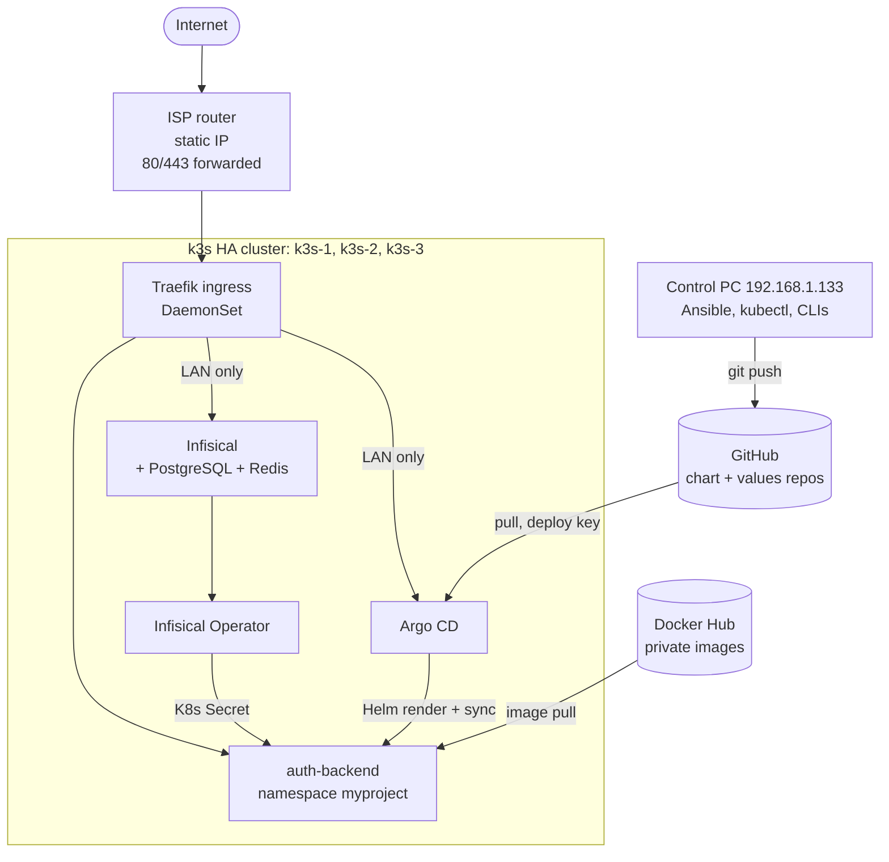
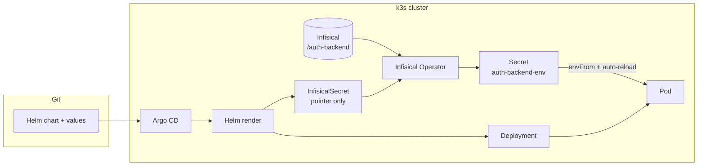
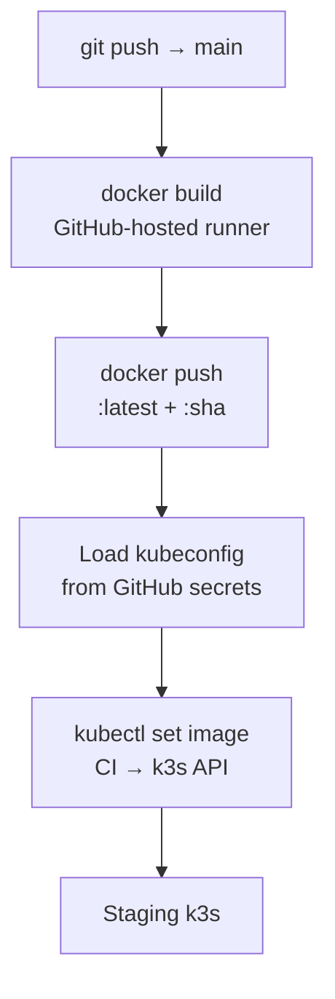
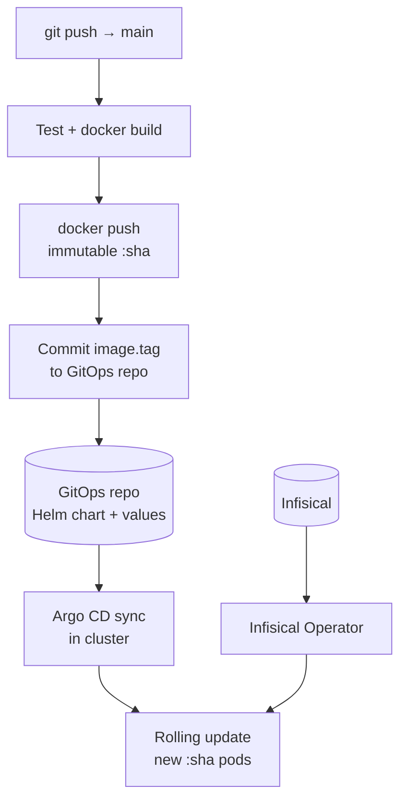

# On-Prem k3s Platform

On-prem Kubernetes platform built on three desktop PCs: a highly available k3s cluster managed with Ansible, exposed through a static public IP, with **Argo CD** for GitOps deployments and **Infisical** for secrets management.

This document records how the platform was built, how it is configured, the problems we hit along the way and how they were fixed, and what is still left to do.

> **Placeholders:** environment-specific values are replaced with `<…>` placeholders (`<PUBLIC_STATIC_IP>`, `<github-org>`, `<gitops-repo>`, `<dockerhub-namespace>`, `<ssh-user>`, `<infisical-project-slug>`, `<router-admin-url>`). `myproject` and `auth-backend` are example names. LAN addresses (`192.168.1.x`) are private, non-routable examples.

---

## Contents

1. [Architecture](#1-architecture)
2. [Inventory: hardware, network and versions](#2-inventory-hardware-network-and-versions)
3. [Network and router setup](#3-network-and-router-setup)
4. [Node preparation](#4-node-preparation)
5. [Cluster installation with Ansible](#5-cluster-installation-with-ansible)
6. [kubectl access and verification](#6-kubectl-access-and-verification)
7. [Ingress, TLS and public exposure](#7-ingress-tls-and-public-exposure)
8. [Infisical (secrets manager)](#8-infisical-secrets-manager)
9. [Argo CD (GitOps)](#9-argo-cd-gitops)
10. [Deploying an application: auth-backend](#10-deploying-an-application-auth-backend)
11. [Infisical Operator integration](#11-infisical-operator-integration)
12. [CI/CD: current vs proposed](#12-cicd-current-vs-proposed)
13. [Troubleshooting log](#13-troubleshooting-log)
14. [Known gaps and roadmap](#14-known-gaps-and-roadmap)
15. [Day-2 operations cheat sheet](#15-day-2-operations-cheat-sheet)

---

## 1. Architecture



Three independent paths reach the application:

| Path | Flow | Notes |
|---|---|---|
| Configuration | Git → Argo CD → Helm chart → cluster | Git is the source of truth; manual changes are reverted (self-heal) |
| Images | Docker Hub → pod | Private repo, pulled with `dockerhub-cred` |
| Secrets | Infisical → Infisical Operator → Kubernetes Secret → pod env | No secret values in Git; pods restart automatically on change |

All three nodes are k3s **servers**: each runs the control plane, an embedded etcd member and regular workloads. With three etcd members (quorum 2 of 3) the cluster keeps working if any one node fails.

---

## 2. Inventory: hardware, network and versions

### Nodes

| Hostname | Hardware | LAN IP | Roles |
|---|---|---|---|
| k3s-1 | i7, 32 GB RAM | 192.168.1.10 | control-plane, etcd, worker |
| k3s-2 | i5, 16 GB RAM | 192.168.1.11 | control-plane, etcd, worker |
| k3s-3 | i5, 16 GB RAM | 192.168.1.12 | control-plane, etcd, worker |
| Control PC | Workstation (fish shell) | 192.168.1.133 (DHCP) | Ansible control node, kubectl |

All nodes run **Ubuntu 26.04.1 LTS** (Desktop), kernel 7.0.0-38-generic, wired Ethernet.

### Network

| Item | Value |
|---|---|
| Router | ISP-provided router, admin UI at `<router-admin-url>` |
| Public static IP | <PUBLIC_STATIC_IP> (on the IPoE internet connection) |
| LAN | 192.168.1.0/24, gateway 192.168.1.1 |
| Port forwards | TCP 80 and 443 → 192.168.1.10 |
| Reserved static range | 192.168.1.2 – 192.168.1.99 (after DHCP pool change, see §3.3) |
| Planned floating IPs | 192.168.1.20 – 192.168.1.29 (MetalLB, see §14) |

### Software versions

| Component | Version |
|---|---|
| k3s | v1.33.5+k3s1 (containerd 2.1.4-k3s1) |
| Argo CD | v3.5.5 (Helm chart `argo/argo-cd` 10.10.5) |
| Infisical | v0.167.0 (Helm chart `infisical-standalone` 1.11.1) |
| Infisical Operator | Helm chart `infisical-helm-charts/secrets-operator` (pinned at install) |
| Traefik | Bundled with k3s, configured via `HelmChartConfig` |

### Service URLs (LAN only)

| Service | URL |
|---|---|
| Argo CD | https://argocd.192.168.1.10.nip.io |
| Infisical | https://infisical.192.168.1.10.nip.io |

`nip.io` is a public DNS service that resolves `anything.192.168.1.10.nip.io` to `192.168.1.10`, so no DNS server or hosts-file edits are needed.

---

## 3. Network and router setup

### 3.1 Static IP verification

The static IP was confirmed in the router status page: the `Internet_IPoE` connection holds `<PUBLIC_STATIC_IP>/24`. The router also has a `VoIP` connection on a private `10.100.x.x` address, which is the ISP's voice network and is not used by the cluster.

### 3.2 Port forwarding

The original router firmware blocked NAT/firewall pages for the customer login (HTTP 403). ISP support replaced the router with a new model, where forwarding is configured under **Network Setting → NAT → Port Forwarding** on the `IPoE-Internet` WAN interface:

| Service | External port | Internal IP | Internal port | Protocol |
|---|---|---|---|---|
| HTTP | 80 | 192.168.1.10 | 80 | TCP |
| HTTPS | 443 | 192.168.1.10 | 443 | TCP |

**Never forward port 6443** (Kubernetes API). Remote cluster administration should go through a VPN such as Tailscale.

**UPnP** was disabled so devices on the LAN cannot open ports on the public IP automatically.

### 3.3 DHCP pool (action required: verify)

The new router's DHCP pool started at `192.168.1.2` with size 253, covering the whole subnet, including the nodes' static IPs. This risks IP conflicts. The pool must be restricted to:

- **IP Pool Starting Address:** `192.168.1.100`
- **Pool Size:** `155` (→ .100 – .254)

Location: **Network Setting → LAN**. Addresses .2 – .99 are then reserved for static use.

### 3.4 NAT loopback limitation

The router does **not support NAT loopback (hairpin NAT)**. From inside the LAN, `http://<PUBLIC_STATIC_IP>` is refused; from outside it works. On the LAN, use the node IP or the `nip.io` hostnames. Long-term fix: a real domain with split DNS (internal DNS resolves to the LAN IP, public DNS to the static IP).

---

## 4. Node preparation

### 4.1 Static LAN IPs

Ubuntu Desktop manages networking with **NetworkManager**, so static IPs are set with `nmcli` (netplan with the default `networkd` renderer does not work here, see [Issue 2](#13-troubleshooting-log)).

```sh
nmcli con show                       # ethernet connection is "netplan-enp1s0"
sudo nmcli con mod "netplan-enp1s0" \
  ipv4.method manual \
  ipv4.addresses 192.168.1.10/24 \
  ipv4.gateway 192.168.1.1 \
  ipv4.dns "1.1.1.1 8.8.8.8"
sudo nmcli con up "netplan-enp1s0"
```

Use `.11` and `.12` on the other nodes. Before assigning, each IP was confirmed free (`ping` returned *Destination Host Unreachable*).

### 4.2 SSH access from the control PC

Ubuntu Desktop does not ship an SSH server:

```sh
# on every node
sudo apt install -y openssh-server

# on the control PC
ssh-keygen -t ed25519
ssh-copy-id <ssh-user>@192.168.1.10
ssh-copy-id <ssh-user>@192.168.1.11
ssh-copy-id <ssh-user>@192.168.1.12
```

Optional `~/.ssh/config` on the control PC:

```
Host k3s-1
    HostName 192.168.1.10
Host k3s-2
    HostName 192.168.1.11
Host k3s-3
    HostName 192.168.1.12
Host k3s-*
    User <ssh-user>
```

---

## 5. Cluster installation with Ansible

The official [k3s-io/k3s-ansible](https://github.com/k3s-io/k3s-ansible) collection installs k3s. With three hosts in the `server` group it sets up HA with embedded etcd automatically.

### 5.1 Control PC setup

```sh
sudo apt install -y ansible
ansible-galaxy collection install community.general
ansible-galaxy collection install git+https://github.com/k3s-io/k3s-ansible.git
```

### 5.2 Project folder `~/k3s-ansible`

**ansible.cfg**

```ini
[defaults]
inventory = inventory.yml
interpreter_python = auto_silent
host_key_checking = True
```

**inventory.yml** (token redacted)

```yaml
k3s_cluster:
  children:
    server:
      hosts:
        k3s-1:
          ansible_host: 192.168.1.10   # i7, 32 GB (cluster-init)
        k3s-2:
          ansible_host: 192.168.1.11   # i5, 16 GB
        k3s-3:
          ansible_host: 192.168.1.12   # i5, 16 GB
  vars:
    ansible_user: <ssh-user>
    ansible_port: 22
    ansible_become_exe: sudo.ws        # Ubuntu 26.04 ships sudo-rs; see Issue 6
    k3s_version: v1.33.5+k3s1
    token: !vault |
      $ANSIBLE_VAULT;1.1;AES256
      ...redacted...
    api_endpoint: 192.168.1.10
    extra_server_args: >-
      --node-ip={{ ansible_host }}
      --tls-san=192.168.1.10
      --tls-san=<PUBLIC_STATIC_IP>
```

The cluster token was generated and encrypted with:

```sh
ansible-vault encrypt_string "$(openssl rand -hex 32)" --name token
```

**prep.yml** prepares the OS on all nodes:

| Task | Purpose |
|---|---|
| Set hostname to inventory name | k3s uses the hostname as node name |
| Point `127.0.1.1` at the new hostname | Prevents sudo "unable to resolve host" warnings |
| Add all nodes to `/etc/hosts` | Nodes resolve each other by name |
| `timedatectl set-ntp true` | etcd and TLS need accurate clocks |
| Install curl | Required by the k3s install script |
| Open k3s ports if ufw is active | 6443, 2379-2380, 10250/tcp; 8472/udp; pod and service CIDRs |

### 5.3 Run

```sh
cd ~/k3s-ansible
ansible all -m ping --ask-vault-pass
ansible-playbook prep.yml --ask-become-pass --ask-vault-pass
ansible-playbook k3s.orchestration.site --ask-become-pass --ask-vault-pass
```

The collection initialises etcd on k3s-1, joins k3s-2 and k3s-3 as servers, waits for all three to become etcd voters and merges a kubeconfig into `~/.kube/config` on the control PC (context `k3s-ansible`).

Keep `~/k3s-ansible` in a private Git repository. The token is vault-encrypted, so the repo is safe to store.

---

## 6. kubectl access and verification

### 6.1 Control PC

The control PC previously ran a separate single-node k3s. Its bundled kubectl ignored `~/.kube/config`. It was removed and a standalone kubectl installed (see [Issue 7](#13-troubleshooting-log)):

```fish
sudo /usr/local/bin/k3s-uninstall.sh
sudo snap install kubectl --classic
set -Ux KUBECONFIG $HOME/.kube/config     # fish shell
kubectl config use-context k3s-ansible
kubectl get nodes -o wide
```

On the nodes, the playbook writes `~/.kube/config` and sets `KUBECONFIG` in `~/.bashrc`; open a new terminal after installation.

### 6.2 Expected result

```
NAME    STATUS   ROLES                       VERSION        INTERNAL-IP
k3s-1   Ready    control-plane,etcd,master   v1.33.5+k3s1   192.168.1.10
k3s-2   Ready    control-plane,etcd,master   v1.33.5+k3s1   192.168.1.11
k3s-3   Ready    control-plane,etcd,master   v1.33.5+k3s1   192.168.1.12
```

### 6.3 Cross-node networking smoke test (passed)

```sh
kubectl create deployment hello --image=nginx --replicas=3
kubectl expose deployment hello --port=80 --type=NodePort
kubectl get pods -o wide        # one pod per node
kubectl get svc hello           # open http://192.168.1.10/.11/.12:<nodeport>
kubectl delete svc,deployment hello
```

Result: the scheduler placed one pod per node and the nginx page loaded on all three node IPs, confirming scheduling, image pulls, flannel pod networking and kube-proxy routing.

---

## 7. Ingress, TLS and public exposure

### 7.1 Traefik configuration

k3s ships Traefik as its ingress controller. It is customised with a `HelmChartConfig` (`~/k3s-ansible/traefik-config.yaml`):

```yaml
apiVersion: helm.cattle.io/v1
kind: HelmChartConfig
metadata:
  name: traefik
  namespace: kube-system
spec:
  valuesContent: |-
    deployment:
      kind: DaemonSet                  # one Traefik pod per node
    service:
      spec:
        externalTrafficPolicy: Local   # preserve real client IPs
```

`externalTrafficPolicy: Local` is required for IP-based allowlists: without it, every request appears to come from an internal address. Running Traefik as a DaemonSet ensures every node has a local Traefik pod to receive traffic.

### 7.2 Keeping admin tools private

Once 80/443 were forwarded, Infisical and Argo CD became reachable from the internet by spoofing the `Host` header. Both are restricted to the LAN and in-cluster traffic with a Traefik middleware (`~/k3s-ansible/lan-only.yml`), one per namespace:

```yaml
apiVersion: traefik.io/v1alpha1
kind: Middleware
metadata:
  name: lan-only
  namespace: infisical          # second copy with namespace: argocd
spec:
  ipAllowList:
    sourceRange:
      - 192.168.1.0/24          # LAN
      - 10.42.0.0/16            # pods inside the cluster
```

Attached through each ingress annotation:

```yaml
traefik.ingress.kubernetes.io/router.middlewares: infisical-lan-only@kubernetescrd   # format: <namespace>-<name>@kubernetescrd
```

**Verification** (from a phone hotspot, i.e. outside the LAN):

| Request | Result |
|---|---|
| `curl http://<PUBLIC_STATIC_IP>` | `404 page not found` (port forward works, no route for bare IP) |
| `curl -k -H "Host: infisical.192.168.1.10.nip.io" https://<PUBLIC_STATIC_IP>` | `Forbidden` |
| `curl -k -H "Host: argocd.192.168.1.10.nip.io" https://<PUBLIC_STATIC_IP>` | `Forbidden` |

**Rule for new services:** every ingress is public by default. Add the `lan-only` middleware to any internal tool (Grafana, Longhorn UI, etc.).

### 7.3 Local certificate authority (mkcert)

Traefik's default certificate is self-signed for a random hostname, which browsers warn about and CLIs reject. A local CA was created with **mkcert** on the control PC:

```sh
sudo apt install -y mkcert libnss3-tools
mkcert -install        # creates the CA and trusts it on this PC
mkcert infisical.192.168.1.10.nip.io infisical.192.168.1.11.nip.io infisical.192.168.1.12.nip.io
mkcert argocd.192.168.1.10.nip.io argocd.192.168.1.11.nip.io argocd.192.168.1.12.nip.io
```

Certificates are loaded as TLS secrets (`infisical-tls`, `argocd-server-tls`) and referenced by the ingresses. Certificates expire in January 2029.

Other machines that use the CLIs must trust the CA: share **only** `rootCA.pem` (location: `mkcert -CAROOT`) and install it with:

```sh
sudo cp rootCA.pem /usr/local/share/ca-certificates/local-dev-ca.crt
sudo update-ca-certificates
```

**Never share `rootCA-key.pem`.** Anyone with it can issue certificates trusted by every machine that trusts the CA.

---

## 8. Infisical (secrets manager)

### 8.1 Install

```sh
helm repo add infisical-helm-charts 'https://dl.cloudsmith.io/public/infisical/helm-charts/helm/charts/'
helm repo update
kubectl create namespace infisical

kubectl create secret generic infisical-secrets -n infisical \
  --from-literal=ENCRYPTION_KEY=<openssl rand -hex 16> \
  --from-literal=AUTH_SECRET=<openssl rand -base64 32> \
  --from-literal=SITE_URL=https://infisical.192.168.1.10.nip.io

helm install infisical infisical-helm-charts/infisical-standalone \
  -n infisical -f infisical-values.yaml --version 1.11.1
```

**`ENCRYPTION_KEY` must be stored in a password manager.** It encrypts Infisical's root key; a database restored without it is unreadable.

### 8.2 `infisical-values.yaml` (passwords redacted)

```yaml
infisical:
  replicaCount: 1
  kubeSecretRef: infisical-secrets

ingress:
  enabled: true
  hostName: infisical.192.168.1.10.nip.io
  ingressClassName: traefik
  nginx:
    enabled: false
  annotations:
    traefik.ingress.kubernetes.io/router.entrypoints: websecure
    traefik.ingress.kubernetes.io/router.tls: "true"
    traefik.ingress.kubernetes.io/router.middlewares: infisical-lan-only@kubernetescrd
  tls:
    - secretName: infisical-tls
      hosts:
        - infisical.192.168.1.10.nip.io

postgresql:
  enabled: true
  auth:
    username: infisical
    password: <48-char hex>      # openssl rand -hex 24
    database: infisicalDB

redis:
  enabled: true
  auth:
    password: <48-char hex>
```

Database passwords must be **hex only**: they are embedded in connection URLs, where characters like `#`, `@`, `/` break parsing (see [Issue 10](#13-troubleshooting-log)). Keep this file out of Git or encrypt it with `ansible-vault`.

### 8.3 Post-install

1. Create the admin account immediately (the first signup becomes the instance admin).
2. Disable open signups in the admin settings.
3. Configure SMTP (pending) so invites and password resets work.

### 8.4 Free vs paid (self-hosted, no license)

| Free | Paid (requires `LICENSE_KEY`) |
|---|---|
| Projects, environments, folders, versioning | Folder/environment-level permissions |
| Built-in roles (Admin, Developer, Viewer) per project | Custom roles, groups |
| Secret references and imports | Approval workflows, access requests |
| CLI, SDKs, Kubernetes Operator | SAML/OIDC SSO |
| Machine identities (Universal Auth, Kubernetes Auth) | Secret rotation, dynamic secrets |
| Secret scanning | Long audit-log retention |

Because roles apply to a whole project, isolate sensitivity levels with **separate projects** (e.g. a separate production project with minimal members).

### 8.5 Local development with the CLI

```sh
infisical login                        # self-hosted: https://infisical.192.168.1.10.nip.io
infisical init                         # links the repo to a project (.infisical.json)
infisical run --env=dev --path=/auth-backend -- ./mvnw spring-boot:run
```

Secrets are injected as environment variables into the process only; nothing is written to disk. For IntelliJ, launch the IDE through Infisical so all run configurations inherit the secrets:

```sh
infisical run --env=dev --path=/auth-backend -- intellij-idea-ultimate
```

Secret scanning as a pre-commit hook:

```sh
infisical scan install --pre-commit-hook
```

---

## 9. Argo CD (GitOps)

### 9.1 Install

```sh
helm repo add argo https://argoproj.github.io/argo-helm
helm repo update
kubectl create namespace argocd
kubectl create secret tls argocd-server-tls -n argocd --cert=<argocd cert>.pem --key=<argocd key>.pem
helm install argocd argo/argo-cd -n argocd -f argocd-values.yaml --version 10.10.5
```

**argocd-values.yaml**

```yaml
global:
  domain: argocd.192.168.1.10.nip.io

configs:
  params:
    server.insecure: true        # Traefik terminates TLS

server:
  ingress:
    enabled: true
    ingressClassName: traefik
    annotations:
      traefik.ingress.kubernetes.io/router.entrypoints: websecure
      traefik.ingress.kubernetes.io/router.tls: "true"
      traefik.ingress.kubernetes.io/router.middlewares: argocd-lan-only@kubernetescrd
    tls: true                    # uses secret argocd-server-tls
```

### 9.2 Admin account and CLI

```sh
# initial password (username: admin)
kubectl -n argocd get secret argocd-initial-admin-secret -o jsonpath="{.data.password}" | base64 -d; echo

# CLI matching the server version (v3.5.5)
curl -fsSL -o argocd https://github.com/argoproj/argo-cd/releases/download/v3.5.5/argocd-linux-amd64
sudo install -m 555 argocd /usr/local/bin/argocd && rm argocd

argocd login argocd.192.168.1.10.nip.io --grpc-web --username admin
argocd account update-password --grpc-web
kubectl -n argocd delete secret argocd-initial-admin-secret
```

`--grpc-web` is required because the CLI reaches Argo CD through Traefik. CLI sessions expire after 24 hours; log in again when you see `token is expired`.

### 9.3 Connecting a private GitHub repository

```sh
ssh-keygen -t ed25519 -f ~/.ssh/argocd-gitops -N "" -C argocd-gitops
# add the .pub as a read-only Deploy key: repo Settings → Deploy keys
argocd repo add git@github.com:<github-org>/<gitops-repo>.git \
  --ssh-private-key-path ~/.ssh/argocd-gitops --grpc-web
argocd repo list --grpc-web      # STATUS: Successful
```

The sample `guestbook` app from `argoproj/argocd-example-apps` was deployed and removed to verify the setup.

---

## 10. Deploying an application: auth-backend

### 10.1 Repository layout

Repo: `<github-org>/<gitops-repo>` (private)

```
<gitops-repo>/
├── argocd/
│   └── auth-backend.yml          # Argo CD Application
└── auth-backend/
    └── auth-backend/                # Helm chart
        ├── Chart.yaml
        ├── values.yaml
        └── templates/
            ├── _helpers.tpl
            ├── deployment.yaml
            ├── service.yaml
            └── infisical-secret.yaml
```

The packaged `.tgz` and `index.yaml` files are not needed: Argo CD reads the chart folder directly from Git.

### 10.2 Image pull secret

The image `<dockerhub-namespace>/auth-backend` is private. A pull secret with a **Read-only** Docker Hub access token (not "Public Repo Read-only") is created once, outside Git:

```sh
kubectl create namespace myproject
kubectl create secret docker-registry dockerhub-cred -n myproject \
  --docker-server=https://index.docker.io/v1/ \
  --docker-username=<dockerhub-username> \
  --docker-password=<read-only-token>
```

### 10.3 Argo CD Application (`argocd/auth-backend.yml`)

```yaml
apiVersion: argoproj.io/v1alpha1
kind: Application
metadata:
  name: auth-backend
  namespace: argocd
spec:
  project: default
  source:
    repoURL: git@github.com:<github-org>/<gitops-repo>.git
    targetRevision: main
    path: auth-backend/auth-backend
    helm:
      valueFiles:
        - values.yaml
  destination:
    server: https://kubernetes.default.svc
    namespace: myproject
  syncPolicy:
    automated:
      prune: true
      selfHeal: true
    syncOptions:
      - CreateNamespace=true
```

Applied once with `kubectl apply -f argocd/auth-backend.yml`. After that, every push to `main` that changes the chart is deployed automatically (polling interval about 3 minutes; force with `argocd app get auth-backend --grpc-web --refresh`).

### 10.4 Key chart values

```yaml
name: auth-backend          # required by the Deployment template
namespace: myproject
replicaCount: 1
image:
  repository: <dockerhub-namespace>/auth-backend
  tag: latest                  # to be replaced by immutable :sha tags (see §12)
  pullPolicy: Always
imagePullSecrets:
  - name: dockerhub-cred
containerPort: 8080
service:
  type: ClusterIP
  port: 80
  annotations:
    prometheus.io/scrape: "true"
    prometheus.io/port: "80"
    prometheus.io/path: "/actuator/prometheus"
resources: {}                  # to be filled in
```

The Deployment template loads app configuration with:

```yaml
envFrom:
  - secretRef:
      name: {{ .Values.name }}-env   # created by the Infisical Operator
      optional: true
```

and carries the annotation `secrets.infisical.com/auto-reload: "true"` so pods restart when secrets change.

### 10.5 Validate before pushing

```sh
helm lint auth-backend/auth-backend
helm template auth-backend auth-backend/auth-backend --namespace myproject
```

Argo CD can only deploy what `helm template` can render. Add both commands as a CI check on pull requests.

---

## 11. Infisical Operator integration

### 11.1 Install the operator

```sh
helm install infisical-operator infisical-helm-charts/secrets-operator \
  -n infisical-operator --create-namespace --version <pinned-version>
kubectl explain infisicalsecret.spec      # confirm field names for this version
```

### 11.2 Machine identity

In Infisical:

1. **Organization → Access Control → Identities → Create** `k3s-myproject`.
2. Add **Universal Auth**, create a **Client Secret**, copy Client ID and Client Secret.
3. In the application project → **Access Control → Machine Identities**, add the identity with role **Viewer**.

Store the credentials in the app namespace (outside Git):

```sh
kubectl create secret generic infisical-universal-auth -n myproject \
  --from-literal=clientId=<client-id> \
  --from-literal=clientSecret=<client-secret>
```

### 11.3 Secrets layout in Infisical

| Setting | Value |
|---|---|
| Project | `<project>` (slug `<infisical-project-slug>`) |
| Environment | `dev` |
| Folder | `/auth-backend` (one folder per service, created in every environment used) |

Folders exist per environment: a folder created in Staging does not exist in Development.

### 11.4 Chart template (`templates/infisical-secret.yaml`)

```yaml
{{- if .Values.infisical.enabled }}
apiVersion: secrets.infisical.com/v1alpha1
kind: InfisicalSecret
metadata:
  name: {{ .Values.name }}
  namespace: {{ .Release.Namespace }}
  annotations:
    argocd.argoproj.io/sync-wave: "-1"
spec:
  hostAPI: {{ .Values.infisical.hostAPI }}
  resyncInterval: {{ .Values.infisical.resyncInterval }}
  authentication:
    universalAuth:
      secretsScope:
        projectSlug: {{ required "infisical.projectSlug is required" .Values.infisical.projectSlug }}
        envSlug: {{ required "infisical.envSlug is required" .Values.infisical.envSlug }}
        secretsPath: {{ .Values.infisical.secretsPath | quote }}
      credentialsRef:
        secretName: {{ .Values.infisical.credentialsSecret }}
        secretNamespace: {{ .Release.Namespace }}
  managedKubeSecretReferences:
    - secretName: {{ .Values.name }}-env
      secretNamespace: {{ .Release.Namespace }}
      creationPolicy: Owner
{{- end }}
```

Values:

```yaml
infisical:
  enabled: true
  hostAPI: http://infisical-infisical-standalone-infisical.infisical.svc.cluster.local:8080/api
  resyncInterval: 60
  projectSlug: <infisical-project-slug>
  envSlug: dev
  secretsPath: /auth-backend
  credentialsSecret: infisical-universal-auth
```

`hostAPI` uses the **in-cluster service address**, which bypasses the LAN-only ingress and the mkcert certificate entirely.

### 11.5 Verify

```sh
kubectl describe infisicalsecret auth-backend -n myproject | tail -25          # ReadyToSyncSecrets: True
kubectl get secret auth-backend-env -n myproject -o jsonpath='{.data}' | grep -o '"[A-Z_]*"'   # names only
kubectl exec -n myproject deploy/auth-backend -- printenv | cut -d= -f1 | sort       # names only
```

**Result:** the operator syncs `/auth-backend` into `auth-backend-env`, the auto-reload annotation triggered a rolling update (Deployment rev 2), and the pod runs with the Infisical values. Argo CD shows the app **Healthy / Synced** with the InfisicalSecret, Secret, Service and Deployment in its resource tree.

### 11.6 How the pieces connect



---

## 12. CI/CD: current vs proposed

### 12.1 Current: push-based



Weak points: cluster admin credentials stored in GitHub; the Kubernetes API must be reachable from the internet; only the image changes through CI, so manifests and hand-edited config drift from Git.

### 12.2 Proposed: pull-based GitOps



| | Current (push) | Proposed (GitOps) |
|---|---|---|
| Who changes the cluster | GitHub Actions via `kubectl` | Argo CD from inside the cluster |
| Cluster credentials in CI | Full kubeconfig | None (Git write access only) |
| Kubernetes API exposed | Required | Not needed |
| Source of truth | Partly Git, partly the server | Git |
| Manual changes | Persist unnoticed | Reverted by self-heal |
| Rollback | Re-run old pipeline | `git revert` of the tag commit |
| Secrets | Config files edited by hand | Infisical via operator |
| Image tags | `:latest` + `:sha` | `:sha` only |

### 12.3 Workflow changes required

1. **Build job:** drop `:latest`, push only `:<short-sha>`; add tests before the build and a Trivy scan before push; use `cache-to: type=gha,mode=max` for multi-stage builds; add OCI labels (`org.opencontainers.image.revision`).
2. **Deploy job:** replace `kubectl set image` with a job that checks out the GitOps repo, sets `image.tag` in the service's `values.yaml`, commits and pushes (with a `git pull --rebase` retry loop for concurrent builds).
3. **Secrets:** remove `K3S_KUBECONFIG` from GitHub; add a token limited to pushing to the GitOps repo.

### 12.4 Repository strategy (decided)

- **One GitOps repo per project** (e.g. a project with ~25 services), not one per service.
- **Helm** for the services: one shared chart, per-service values files, generated with an ApplicationSet (matrix of services × environments).
- **Kustomize** acceptable for small one-off setups.
- Shared chart starts inside the GitOps repo; once shared across projects, publish it as an OCI artifact to Docker Hub (paid plan, private repositories) and pin versions.

---

## 13. Troubleshooting log

Every issue hit during the build, in order.

| # | Symptom | Root cause | Fix |
|---|---|---|---|
| 1 | Router Firewall menu missing; LuCI port-forward page returns `403 Forbidden` | ISP firmware blocks NAT settings for the customer login | ISP replaced the router and port forwarding was configured there |
| 2 | `netplan try`: *systemd-networkd is not running*, *dbus-org.freedesktop.network1.service not found* | Ubuntu Desktop uses NetworkManager; netplan file without `renderer` targets networkd | Let it revert, delete the netplan file, set the IP with `nmcli` on `netplan-enp1s0` |
| 3 | `ansible all -m ping`: *No inventory was parsed* | Project folder empty; files not copied in | Copy inventory and playbooks into `~/k3s-ansible` |
| 4 | Playbooks: *skipping: no hosts matched* | `ansible.cfg` missing, so `inventory.yml` not loaded | Create `ansible.cfg` (or pass `-i inventory.yml`) |
| 5 | `fish: Expected a string, but found a redirection` | fish shell does not support bash heredocs | Use `printf '%s\n' … > file` or `bash -c '…'` |
| 6 | *Timeout (12s) waiting for privilege escalation prompt*, hosts UNREACHABLE | Ubuntu 26.04 uses **sudo-rs**; Ansible does not recognise its prompt | `ansible_become_exe: sudo.ws` (classic sudo) in the inventory |
| 7 | kubectl on control PC: *permission denied* on `/etc/rancher/k3s/k3s.yaml`; with sudo shows node from the old local cluster | A separate local k3s existed; its bundled kubectl ignores `~/.kube/config` | Uninstalled local k3s, installed kubectl via snap, `set -Ux KUBECONFIG $HOME/.kube/config` |
| 8 | kubectl on nodes: *permission denied* | Terminal opened before the playbook set `KUBECONFIG` in `.bashrc` | Open a new terminal or `export KUBECONFIG=~/.kube/config` |
| 9 | k3s-3 briefly `NotReady` with only the etcd role; *FAILED - RETRYING* in playbook | Captured mid-join; playbook polling | None needed |
| 10 | Infisical crash: *Invalid port in url* `redis://default:<password>@…` | `#` in the Redis password breaks the connection URL | Use hex-only passwords (`openssl rand -hex 24`) |
| 11 | Infisical: *password authentication failed for user "infisical"* | PostgreSQL password is fixed in the data volume at first init; changing Helm values does not change it | Clean reinstall: `helm uninstall`, `kubectl delete pvc --all -n infisical`, reinstall. With data present, use `ALTER USER` first |
| 12 | Infisical CLI: *x509: certificate is valid for …traefik.default* | Traefik default self-signed cert | mkcert local CA + TLS secret on the ingress |
| 13 | `helm upgrade`: *yaml: line 14: did not find expected key* | `tls:` block indented 4 spaces instead of 2 | Fix indentation (two spaces per level) |
| 14 | `fork/exec ./mvnw: permission denied` | Maven wrapper not executable | `chmod +x mvnw` and `git update-index --chmod=+x mvnw` |
| 15 | Infisical "Manage Access" shows *Upgrade Secrets Manager* | Folder-level access is a paid feature | Use project-level Access Control; separate projects per sensitivity |
| 16 | `/usr/local/bin/argocd: Not: not found` | Download URL used the placeholder `v3.x.y`; a 404 page was installed | Read the version from the running image, download with `curl -f` |
| 17 | `fish: Expected a string…` / *improper constraint: "argo-cd-10.10.5"* | Placeholder `<…>` pasted into fish; `--version` given the release name | Use the bare chart version `10.10.5` |
| 18 | `http://<PUBLIC_STATIC_IP>` refused from inside the LAN | Router has no NAT loopback | Test from outside (hotspot); use LAN IP inside; long-term split DNS |
| 19 | Infisical/Argo CD reachable from the internet via `Host:` header | Ingress routes by hostname, not by arrival IP | Traefik DaemonSet + `externalTrafficPolicy: Local` + `lan-only` middleware |
| 20 | Argo CD `ComparisonError`: *YAML parse error on deployment.yaml line 12* | Template was a partial excerpt containing a literal `...` | Replaced with a complete Deployment template |
| 21 | *Deployment:undefined*, *resource name may not be empty* | Template uses `.Values.name`, missing from `values.yaml` | Add `name:`; use `required` for mandatory values |
| 22 | *nil pointer evaluating .Values.service.annotations* | `values.yaml` overwritten instead of merged | `git checkout` the original file and add only the new keys |
| 23 | App stuck *Syncing, retrying attempt #5* after the fix | Auto-sync retries the old failed revision | `argocd app terminate-op`, then `argocd app sync` |
| 24 | `ImagePullBackOff`, *401 Unauthorized* from auth.docker.io | Wrong credentials in `dockerhub-cred` | Recreate the secret with a working Read-only token; delete the pod |
| 25 | Argo CD CLI: *token is expired* | CLI sessions last 24 hours | `argocd login … --grpc-web` |
| 26 | Operator: *Slug field can only contain lowercase letters, numbers, and hyphens* | `projectSlug` still the placeholder `<project-slug>` | Use the real slug from Project Settings (`<infisical-project-slug>`) |
| 27 | Operator: *Folder with path '/auth-backend' in environment 'dev' was not found* | Folder did not exist in the `dev` environment | Create the folder in Development (folders are per environment) |
| 28 | New router DHCP pool covers .2 – .254 | Overlaps static node IPs and planned floating IPs | Restrict pool to .100 – .254 (verify, §3.3) |

**General lessons**

- Generate passwords with `openssl rand -hex`; special characters break connection URLs.
- Never paste placeholders (`<…>`) into fish; `<` is a redirection.
- Render charts locally (`helm template`) before pushing; Argo CD cannot deploy what Helm cannot render.
- Merge values files, never replace them.
- Argo CD "Synced" only means cluster objects match Git; secret values and pod restarts are the operator's job.

---

## 14. Known gaps and roadmap

| Priority | Gap | Risk | Plan |
|---|---|---|---|
| High | Node-local storage (local-path); Infisical PostgreSQL pinned to k3s-3 | Disk or node loss loses all secrets | Install **Longhorn** (replicated volumes); move PostgreSQL onto it |
| High | No backups of Infisical DB or etcd off-node | Unrecoverable failure | Scheduled `pg_dump` and k3s etcd snapshots to MinIO/S3; keep `ENCRYPTION_KEY` separately; test a restore |
| High | DHCP pool overlap | IP conflicts with nodes | Restrict pool (§3.3) |
| High | Credentials displayed during setup (terminal output, screenshots) | Leaked secrets | Rotate DB passwords (via `ALTER USER`), Docker Hub tokens, Infisical client secrets |
| Medium | Port forward targets one node (k3s-1) | Public access lost if k3s-1 is down | **MetalLB** floating IP `192.168.1.20`, then repoint forwards and move hostnames to `.20.nip.io` |
| Medium | `:latest` image tags | Argo CD cannot detect new builds | Immutable `:sha` tags + CI tag-bump commits (§12) |
| Medium | Nodes join via 192.168.1.10 | New joins fail if k3s-1 is down | kube-vip floating IP for the API |
| Medium | Per-namespace pull secrets | Repetition across 25 services | Docker Hub credentials in `/etc/rancher/k3s/registries.yaml` via Ansible |
| Medium | Universal Auth client secret stored in cluster | Long-lived credential | Switch operator to Kubernetes Auth |
| Medium | No SMTP in Infisical | Invites and resets do not email | Configure `SMTP_*` in `infisical-secrets` |
| Low | Single CoreDNS replica | ~5 min DNS gap on node loss | Acceptable for PoC |
| Low | No UPS | Power cuts can corrupt etcd | UPS for nodes and router |
| Low | No real domain | No public HTTPS, NAT loopback issue | Domain + cert-manager (Let's Encrypt) + split DNS |
| Low | Docker also installed on k3s-1 | Extra load | Move CI into the cluster (Actions Runner Controller) |
| Low | Remote admin access | — | Tailscale; never forward 6443 |

---

## 15. operations cheat sheet

```sh
# Cluster health
kubectl get nodes -o wide
kubectl get pods -A -o wide
kubectl top nodes
kubectl get lease -n kube-system               # current scheduler/controller leaders

# k3s on a node
journalctl -u k3s -f
sudo.ws k3s etcd-snapshot ls

# Upgrade k3s: bump k3s_version in inventory.yml, then
ansible-playbook k3s.orchestration.upgrade --ask-become-pass --ask-vault-pass

# Restart k3s one node at a time
ansible server -b -m ansible.builtin.systemd -a "name=k3s state=restarted" --forks 1 --ask-become-pass --ask-vault-pass

# Argo CD
argocd login argocd.192.168.1.10.nip.io --grpc-web --username admin
argocd app list --grpc-web
argocd app get <app> --grpc-web --refresh
argocd app sync <app> --grpc-web
argocd app terminate-op <app> --grpc-web

# Infisical operator
kubectl get infisicalsecret -A
kubectl describe infisicalsecret <name> -n <namespace> | tail -25

# Debug a pod
kubectl describe pod <pod> -n <namespace>       # events: image pulls, probes, scheduling
kubectl logs -n <namespace> deploy/<name> --tail=100
kubectl rollout restart deployment <name> -n <namespace>

# Helm releases
helm list -A
helm upgrade infisical infisical-helm-charts/infisical-standalone -n infisical -f infisical-values.yaml --version 1.11.1
helm upgrade argocd argo/argo-cd -n argocd -f argocd-values.yaml --version 10.10.5
```

**Rules of thumb**

1. Change application deployments only through Git, Argo CD reverts manual edits.
2. Pin every chart and image version; upgrade deliberately and back up first.
3. Never commit secret values; only `InfisicalSecret` references.
4. Add the `lan-only` middleware to every internal tool's ingress.
5. Keep `~/k3s-ansible`, the values files (encrypted) and this README in a private repository.
